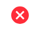
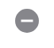
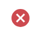

.. Sorgente della pagina. La versione HTML (icone-di-stato.html) si rigenera con:
   rst2html5 --language=it --embed-stylesheet --stylesheet-path=minimal.css,plain.css,stile.css \
             icone-di-stato.rst icone-di-stato.html

=====================================================
Icone di stato di GovWay: convenzione e sua logica
=====================================================

:Prodotto: GovWay 3.4.4 — console di gestione (govwayConsole) e console di monitoraggio (govwayMonitor)
:Criteri: WCAG 2.1 — 1.4.1 Uso del colore, 1.4.11 Contrasto non testuale, 1.1.1 Contenuti non testuali
:Data: 20 novembre 2026
:Revisione prevista: entro il 20 novembre 2027

.. contents:: Indice
   :local:
   :depth: 1

Perché questa pagina
====================

Nelle due console di GovWay molti stati si distinguevano **solo dal colore**: pallini verdi, gialli e
rossi tutti uguali, glifi diversi solo per tinta, barre e fette dei grafici collegate alla legenda dal
solo colore. Chi non distingue i colori, o li vede in modo diverso, non riceveva l'informazione
(WCAG 1.4.1).

Ogni caso è stato censito a mano, pagina per pagina, e corretto con un'unica convenzione: **la forma
porta il significato, il colore si aggiunge**. Questa pagina riporta la convenzione, le icone scelte,
la logica di ogni scelta e i rapporti di contrasto misurati.

È anche la prova che giustifica la voce ``style_color_misuse`` nei registri dei falsi positivi di
questo target (``falsePositives.govway_console.json`` e ``falsePositives.govway_monitor.json``): vedi
`La regola IBM style_color_misuse`_.

La convenzione
==============

Le stesse forme valgono in tutte e due le console. Il significato, però, non è lo stesso ovunque:
per questo le icone sono divise in **famiglie**, e dove il significato cambia cambia anche il simbolo.

.. list-table:: Simboli comuni
   :header-rows: 1
   :widths: 22 30 48

   * - Simbolo
     - Significato
     - Logica
   * - cerchio con spunta
     - ok, abilitato
     - la spunta è il segno universale di «a posto»; la lista transazioni la usava già per l'esito Ok
   * - triangolo con «!»
     - avviso
     - la forma dell'avviso nella segnaletica di sicurezza (ISO 3864) e nelle principali librerie di
       interfaccia (Microsoft Fluent, Apple SF Symbols, Material, Bootstrap)
   * - cerchio con X
     - errore
     - la X aggiunge un secondo indizio oltre al contorno; evita anche che il cerchio con «!» abbia
       significati diversi in punti diversi
   * - cerchio con trattino
     - disabilitato
     - «spento», distinto dall'errore: un'API disabilitata non è un'API sbagliata
   * - cerchio pieno a metà
     - parzialmente abilitato
     - lo stato fra i due estremi; resta giallo, fra il verde e il rosso

Stato di un'entità (console e monitor)
--------------------------------------

API, erogazioni, fruizioni, gruppi, connettori multipli, utenti; nel monitor lo stato del gateway
nell'intestazione e nella pagina di stato, la gravità degli eventi, lo stato delle API in
Configurazione API. Immagini SVG di 16×16 px con un **alone bianco**, che le stacca anche dal blu
dell'intestazione.

.. list-table::
   :header-rows: 1
   :widths: 10 25 65

   * - Icona
     - Significato
     - Dove e con quale testo
   * - |s-ok|
     - ok / abilitato
     - «API attiva», «API correttamente configurata», «Configurazione abilitata», «Utente con
       abilitazioni valide»; stato del gateway Ok; eventi INFO e DEBUG; API abilitata
   * - |s-avviso|
     - avviso
     - API con azioni mancanti su alcuni servizi o con avvisi di profilo; connettore con scheduling
       della consegna disabilitato; stato del gateway Warning; eventi WARN
   * - |s-errore|
     - errore
     - API senza risorse, servizi o azioni; controllo degli accessi con autorizzazione senza
       fruitori, ruoli o scope; utente non valido o con password scaduta; stato del gateway Error;
       eventi ERROR e FATAL
   * - |s-parziale|
     - parzialmente abilitato
     - «Alcuni gruppi dell'API sono disabilitati» (elenco erogazioni e fruizioni, Configurazione API)
   * - |s-dis|
     - disabilitato
     - API, gruppo o connettore disabilitato; colonna «Abilitato» delle porte (modalità avanzata)
   * - |s-nonattivo|
     - non attivo
     - gruppo predefinito con tutte le risorse riassegnate ad altri gruppi; API senza stato

Singola funzionalità configurata (console)
------------------------------------------

Righe della pagina Configurazione di erogazioni e fruizioni (Controllo accessi, Rate limiting,
Validazione, CORS, Caching, Sicurezza messaggio, MTOM, Trasformazioni, Tracciamento, Registrazione
messaggi, Proprietà, Opzioni avanzate) ed elenchi di policy, plugin, handler e regole.

Qui il significato è diverso dallo stato di un'entità: dice se **una funzionalità** è abilitata e
configurata bene. Resta il **sigillo** che la console usava già, così la funzionalità si riconosce a
colpo d'occhio dall'entità (cerchio); cambia il simbolo interno, che segue la convenzione. Prima le
quattro icone avevano tutte la spunta, anche quella di «Disabilitato». Disegno di 12 px dentro un
riquadro di 16 px, come le icone precedenti.

.. list-table::
   :header-rows: 1
   :widths: 10 30 60

   * - Icona
     - Significato
     - Esempi
   * - |f-ok|
     - abilitata e configurata
     - «Abilitato», autenticazione e autorizzazione attive
   * - |f-avviso|
     - abilitata, non bloccante
     - «WarningOnly» di Rate limiting, Validazione e policy; autenticazione «Opzionale»
   * - |f-errore|
     - abilitata ma configurata in modo errato
     - sicurezza o MTOM incompleti, autorizzazione senza fruitori, trasformazione che non trasforma
       nulla: il testo visibile può restare «Abilitato», la X dice l'errore e il motivo è nel testo
       alternativo
   * - |f-dis|
     - disabilitata
     - «Disabilitato»

Stato di salute degli allarmi (console)
---------------------------------------

La riga «Allarmi» della Configurazione e l'elenco degli allarmi quando mostra gli stati. È uno stato
di salute, non una configurazione: usa le forme degli allarmi del monitor, a 12 px.

.. list-table::
   :header-rows: 1
   :widths: 10 90

   * - Icona
     - Significato
   * - |a-ok|
     - Ok
   * - |a-warn|
     - Warning
   * - |a-err|
     - Error
   * - |a-dis|
     - allarme disabilitato, oppure abilitato ma senza stato («Stato non disponibile»)

Allarmi del monitor
-------------------

Elenco e riepilogo in alto. Glifi del font Material Icons già caricato dal monitor. Le stesse forme
valgono con e senza la presa in carico; prima, senza presa in carico, tutti gli stati erano lo stesso
pallino.

.. list-table::
   :header-rows: 1
   :widths: 14 86

   * - Icona
     - Significato
   * - |m-ok|
     - Ok (``check_circle``)
   * - |m-warn|
     - Warn (``warning``)
   * - |m-err|
     - Error (``cancel``)
   * - |m-dis|
     - Disabilitato (``do_not_disturb_on``)
   * - |m-warn-ack| |m-err-ack|
     - preso in carico (acknowledge): la stessa icona con una piccola spunta nell'angolo. Prima era un
       glifo diverso, uguale per Warn ed Error e distinto solo dal colore

Esiti delle transazioni e grafici (monitor)
-------------------------------------------

.. list-table::
   :header-rows: 1
   :widths: 14 14 72

   * - Lista
     - Grafico
     - Esito
   * - |t-ok|
     - |g-ok|
     - Ok
   * - |t-fault|
     - |g-fault|
     - Fault applicativo (prima nella lista era il cerchio con «!»)
   * - |t-ko|
     - |g-ko|
     - Fallita (prima nella lista era il triangolo: i due glifi erano invertiti rispetto alla
       convenzione)

Gli stessi glifi sono usati nella lista delle transazioni (vista personalizzata e Live), accanto
all'etichetta «Esito» del dettaglio della transazione e nelle consegne ai connettori multipli; nella
vista classica le immagini sono le SVG delle entità (|s-ok| |s-avviso| |s-errore|).

Nei grafici a barre per esito l'icona compare **sopra ogni colonna non vuota** e nella legenda; le
colonne a zero non hanno icona. Le icone sono disegnate in SVG, non con il font, così restano
corrette anche nell'esportazione del grafico come immagine.

Nelle **torte** la percentuale stampata sulla fetta è seguita dal numero della voce di legenda, per
esempio «35.4% (1)»: senza, la fetta si collegava alla sua voce solo dal colore. Le fette troppo
piccole per avere un'etichetta restano collegate dal colore e dal suggerimento; per loro
l'alternativa testuale è il report «Tabella» della stessa distribuzione, a cui rimanda anche il nome
accessibile del grafico.

Tracciamento PDND (monitor)
---------------------------

.. list-table::
   :header-rows: 1
   :widths: 14 86

   * - Icona
     - Stato dell'invio
   * - |m-ok|
     - inviato
   * - |p-pend|
     - in elaborazione (orologio pieno)
   * - |m-err|
     - errore, pubblicazione fallita
   * - |p-wait|
     - in attesa (cerchio con puntini)

Lo stato è anche annunciato ai lettori di schermo; prima era solo nel suggerimento al passaggio del
mouse.

Contrasti
=========

Per WCAG 1.4.11 ogni parte grafica necessaria a capire lo stato deve avere almeno **3:1**: il
contorno contro lo sfondo della pagina e il simbolo interno contro il riempimento. I rapporti sono
calcolati con la formula WCAG della luminanza relativa sugli sfondi reali: bianco, ``#f6f6fc`` (righe
alterne), ``#daffda`` (riga sotto il puntatore), ``#214171`` (intestazione del monitor), ``#46464e``
(riepilogo degli allarmi).

.. list-table::
   :header-rows: 1
   :widths: 30 25 45

   * - Elemento
     - Colore
     - Rapporto minimo
   * - verde (entità, funzionalità)
     - ``#2e9e44``
     - 3,45:1 la spunta bianca sul verde; 3,20:1 sulle righe alterne, con bordo ``#1e7a2c``
   * - rosso (entità)
     - ``#e53935``
     - 4,23:1 la X bianca sul rosso
   * - giallo (avviso, parziale)
     - ``#f9ce1d``, bordo ``#7a5f00``
     - il giallo sul bianco ha 1,5:1, quindi la forma la danno bordo e divisorio scuri: 6,06:1 sul
       bianco, 4,00:1 sul giallo; «!» scuro sul giallo 10,5:1
   * - grigio (non attivo)
     - ``#86868b``
     - 3,37:1 sulle righe alterne; il trattino bianco 3,62:1
   * - sigillo arancio
     - ``#fbb03b``, bordo ``#7a4e00``
     - bordo 7,20:1 sul bianco; «!» 8,62:1
   * - sigillo rosso
     - ``#ff0000``
     - 4,00:1 la X bianca
   * - sigillo grigio
     - ``#46464e``
     - 9,35:1
   * - alone delle icone di entità
     - bianco
     - 10,2:1 sul blu dell'intestazione
   * - allarmi e PDND su fondo chiaro
     - ``#ff2d39``, ``#b87b36``, ``#009c4b``, ``#86868b``
     - 3,26:1 nel caso peggiore (arancio sulla riga sotto il puntatore). Prima i colori del Tracciamento
       PDND erano quelli pensati per il fondo scuro: arancio 1,9:1, grigio 1,8:1, verde 2,7:1
   * - allarmi sul riepilogo scuro
     - ``#ff5660``, ``#ffab4d``, ``#00b658``, ``#c2c2c9``
     - 3,01:1 nel caso peggiore (rosso)
   * - glifi delle transazioni
     - ``#3f3f47``
     - 4,85:1 sul rosso chiaro della cella Fallita
   * - icone dei grafici
     - colore della serie scurito
     - il colore si scurisce finché arriva ad almeno 3:1 sul bianco; il simbolo interno è bianco

Realizzazione
=============

* **Una sola scelta dell'icona** per le due console: la classe ``IconaStato`` del package condiviso
  ``org.openspcoop2.web.lib.mvc`` (``tools/web_interfaces/lib/mvc``). La usano i JSP della console al
  posto delle 16 copie della scelta che c'erano, e nel monitor l'intestazione e Configurazione API.
* **Valori di stato con un significato proprio**: ``CheckboxStatusType`` ha ora ``PARZIALE`` ed
  ``ERRORE``, oltre ad ``ABILITATO``, ``DISABILITATO`` e ``WARNING_ONLY``. Prima il rosso valeva sia
  «disabilitato» sia «errore», e il giallo sia «parziale» sia «avviso»: sostituire le immagini non
  bastava.
* **Immagini**: le SVG di questa pagina sono quelle di GovWay, in
  ``tools/web_interfaces/lib/web-content/images/tema_link``.
* **Testo alternativo**: è lo stato stesso, non più la parola fissa «Stato».

Casi censiti e corretti
=======================

Console di gestione:

* elenchi di erogazioni, fruizioni, API, utenti, allarmi, policy, plugin, handler, regole;
* dettaglio di erogazioni, fruizioni e API (stato accanto al nome);
* pagina Configurazione dei gruppi (stato del gruppo e righe delle funzionalità);
* connettori multipli;
* date di scadenza dei certificati, rosse e ora seguite da «(scaduto)».

Console di monitoraggio:

* intestazione, pagina di stato, Eventi;
* allarmi (elenco e riepilogo, con e senza presa in carico);
* lista delle transazioni (vista personalizzata, vista classica e Live), dettaglio della transazione e
  consegne ai connettori multipli;
* Configurazione API;
* Tracciamento PDND;
* grafici a barre per esito e torte di Analisi Statistica e del cruscotto Monitoraggio Transazioni.

Casi esaminati e lasciati come sono, perché il colore non è l'unico mezzo: colonne esito e latenza
delle transazioni (colore ridondante con glifo e codice HTTP), collegamenti nel testo (coperti dalla
regola automatica di axe, senza violazioni).

La regola IBM style_color_misuse
================================

IBM Equal Access segnala con ``style_color_misuse`` **ogni foglio di stile** che usa colori, e chiede
di verificare a mano che il colore non sia l'unico modo di trasmettere un'informazione. Non indica un
difetto preciso, e nessuna correzione la fa sparire: compare su ogni pagina con un CSS che usa colori.

La verifica che chiede è stata fatta caso per caso, come descritto in questa pagina, e i casi trovati
sono stati corretti. Per questo i registri dei falsi positivi di console e monitor hanno una voce per
la regola, che rimanda qui e ha una **scadenza**: alla scadenza la verifica va rifatta, controllando
le pagine nuove o cambiate.

Origine delle immagini
======================

Le SVG sono parte di GovWay (GPLv3, Link.it). Le immagini PNG dei glifi del monitor sono rese del
font Material Icons (Apache 2.0) con i colori del monitor, e sono state catturate dalle pagine
installate.
